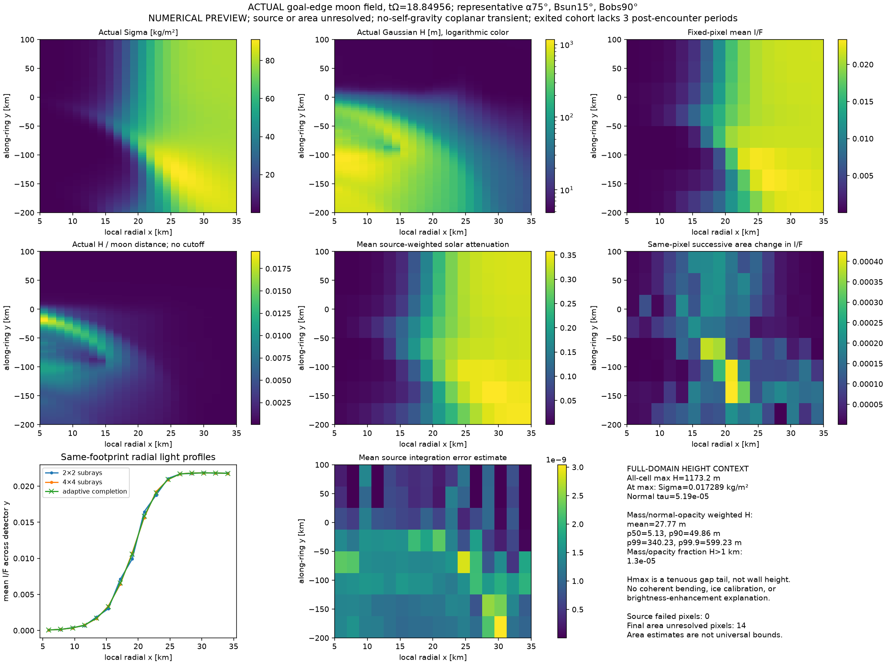

# Keeler gap: results and limits

All three scientific goals remain **not established**. The code is an experimental pipeline with reviewed references and 27 small regression tests, not a validated physical explanation. Conservation and positivity checks expose failures; they do not establish physical accuracy.

## Material retreat

**Version scope:** the completed long-domain trajectories and wave figure below use the older, pre-boundary-fix reconstruction. The later boundary fix intentionally changes normal reconstruction in boundary cells. It does not reset stored cell averages or change forces or physical parameters, but can change numerical diffusion. Historical bitwise consolidation parity does not apply across this change. New paired comparisons must use the same corrected scheme.

The independently audited continued moon/no-moon trajectories both reach tau=22.21, where tau=Omega×time. The moon retains 98.556949% of its original tagged mass. Its retained-cohort local guiding-center difference from control is **+928.339695 m**. The exported 1.443051% has a recorded at-exit guiding center of 27.609394 km, but no later evolution in this domain. Combining retained and at-exit contributions gives **+1015.346193 m**. That mixes times; it is not the same-time all-cohort mean. The 87.006498 m change is selection/proxy sensitivity, not an error bound or corrected retreat.

The 99.9% net-flux crossing proxies are tau=3.350606/3.328668. Final output is 3.001566/3.005057 orbital periods later. These are cohort thresholds, not individual encounter ages. All ten state fields, grids, origin references and dependency snapshots match across continuation handoffs; summed budgets replay within 1.46×10⁻¹¹. This validates continuation bookkeeping, not physical convergence. The earlier finite-outlet +575.632 m result is not the final retreat conclusion.

A cold planar comparison quantifies one approximation for the selected cohort: Hill mean guiding-center change 324.068 m versus global osculating semimajor-axis change 324.176 m, a −0.108 m finite-time discrepancy. It does not validate a warm collisional closure or an asymptotic endpoint. The original comparison also found up to 9.16 m polar-radius and 140.2 m along-track discrepancies. The Hill proxy `x+2w` must not be called exact global semimajor axis. Several-kilometer asymptotic retreat remains unproven.

## Brightness

Two calibrated Cassini products have verified downloads and a restricted native I/F reader. Negative calibrated noise is retained. Strip profiles remain descriptive: edge neighborhoods are neither isolated crests nor proven undisturbed controls. PIA associations are inferred, not official frame cross-references. No measured crest enhancement has been established. Primary image context: [NASA Edge Waves](https://science.nasa.gov/resource/edge-waves/) and [Tiny Moon, Looming Shadows](https://science.nasa.gov/resource/tiny-moon-looming-shadows/).

The reviewed actual-field preview below uses unchanged Sigma/H fields with single scattering. It took **1074.7 seconds**. Source integration has zero failed pixels, but **14/128 detector pixels remain area-unresolved**: maximum successive change 4.24×10⁻⁴ I/F exceeds the 2×10⁻⁴ target. Successive area changes are estimates, not rigorous bounds. This is an unresolved numerical preview, not a resolved image or explanation of observed bright edges.



*Representative phase 75°, solar elevation 15°, vertical observer; no self-gravity, coplanar mean Z=0. This is not Cassini geometry or a fit. The plotted snapshot is the earlier three-elapsed-orbit finite-domain run, not the continued long-domain result. Full source fields supply attenuation; only the detector footprint is cropped. Input/model/driver hashes and error status are in [figure metadata](docs/wave-preview.json). The artifact driver differs from the public default 8×4 bridge.*

## Height and damping

Gaussian H is centered thickness; signed mean Z is coherent bending. Visible wall/shadow height depends on density, optical depth and geometry. They are not interchangeable. In the plotted first moon run, initial H=5 m becomes full-domain mass-weighted mean 27.77 m. Maximum H=1173 m lies in a tenuous tail with normal optical depth 5.19×10⁻⁵; only 1.30×10⁻⁵ of mass has H above 1 km. Mass weighting is not radiance weighting, and this maximum is not a measured wall.

The long-run retained-cohort H and vertical kinetic energy do not show a falling post-encounter envelope. No damping fit is imposed, and no observed damping rate is reproduced. The present continuum cannot represent coherent Z.

A separate native global control with measured early-Cassini e/i amplitudes gives sampled maximum |z|=165–586 m without a prescribed height force. Planar/no-moon controls remain exactly planar; reflected orientations reverse z. Timestep refinement changes matched-time z by at most 0.054 mm. Cohort spread is not local thermal H. Spherical Saturn omits J2/precession; orientation choices are not observed epoch fits. This establishes a coherent gravity channel, not localized collisional walls or damping. See [Jacobson et al. (2008), Table 2](https://doi.org/10.1088/0004-6256/135/1/261) and [Torii et al. (2025)](https://arxiv.org/abs/2504.10989).

## Physical inputs and error gates

Saturn GM=3.793120623×10¹⁶ m³/s² is from [JPL](https://ssd.jpl.nasa.gov/sats/phys_par/). Daphnis mass 6.8×10¹³ kg is adopted. Measured mean-element amplitudes are e=(3.31±0.62)×10⁻⁵ and i=0.0036±0.0013°. Assumed grains have radius 0.5 m, density 500 kg/m³, restitution 0.5 and Enskog enhancement 1. The 8704-cell initial long-domain model represents 6.506 billion such grains, including 5.161 million tagged grains; Gaussian moments do not track them individually.

At fixed Sigma/H/covariance, radius 0.25→1 m reduces instantaneous cooling about fourfold. This is conditional source sensitivity, not evolved retreat or material calibration. The [Latter–Ogilvie collision setting](https://arxiv.org/html/0803.4123v1) assumes smooth Gaussian molecular chaos; responding self-gravity, wakes, friction and spin remain absent.

[Offline epoch inputs](data/epochs/README.md) distinguish the 2009 local observer elevation −52.5576° from Saturn-center −57.5077°. The nominal outer radius 136522 km is 4 km inside the control edge 136526 km. Neither audit supplies pixel navigation or a fitted edge.

Continued moon/control costs are **4074.554/2928.925 seconds** (67.91/48.82 minutes): the moon misses the one-hour total target. The old-scheme final moon energy residual is 320.711 in integrated solver units, **not joules**. Small mass/tag residuals do not prove a small physical energy error. Compatibility work, transport/source cancellation and unresolved mixing require goal-level refinement.

The fresh same-corrected-scheme raw comparison near tau=3.144 gives coarse/fine tagged-cohort H RMS 33.0792/28.8170 m: **14.79% using the fine denominator**, failing the provisional 10% screen. Vertical kinetic/vertical-energy differences are 21.59%/24.96%. Both retain 100% of tag; frame times differ by 0.000113 Omega⁻¹. These are raw-cohort differences, not matched-control excesses.

The corrected outlet study is **incomplete**: coarse moon reaches tau=12 in 982 s with 99.951% exported; fine moon stops at tau=8.02167 in 1604 s with an application-domain failure. Its positive-density cell N/N0=6.4×10⁻¹⁶ reaches H/r=56.94 despite numerical realizability. Fine control stops at tau=9.45593 in 828 s with 90.25% exported; coarse control was not launched before the operational cutoff. Incompleteness is not proof that a one-hour compute budget failed.

The fine failure was classified **post hoc** after its cap. The current automatic guard was added afterward and must not be credited retroactively: every occupied moon-forced cell must satisfy H/r≤0.1, including trial and source-midpoint states. It now preserves last accepted/failed states and raises without a density mask, floor, force replacement or retry to hide the violation. No-moon controls skip this moon-specific screen. Thus no converged corrected-scheme outlet or physical retreat/damping conclusion follows.

## Reproduce controls and next step

```sh
python -m pip install -r requirements.txt -r requirements-build.txt
python collision/native/build.py
python -m unittest discover -s tests -v
python -m data.geometry
python -m baseline.inclined --out results/inclined
python -m continuum.pilot --nx 32 --ny 128 --ylo -200 --yhi 200 --width 4 --end .06283185307179587 --threads 2 --output results/smoke
```

Use new output paths. [SI export/light commands](observation/BRIDGE.md) produce numerical previews; they do not recreate the cropped artifact figure exactly.

The next small physics slice is the 15-moment joint-Gaussian bending contract, retaining coherent Z and cross-covariances. Its zero-dimensional checks pass. Spatial tilted-layer transport/traction, covariance positivity and energy/boundary tests must pass before a full bending solver or observation comparison is claimed.
