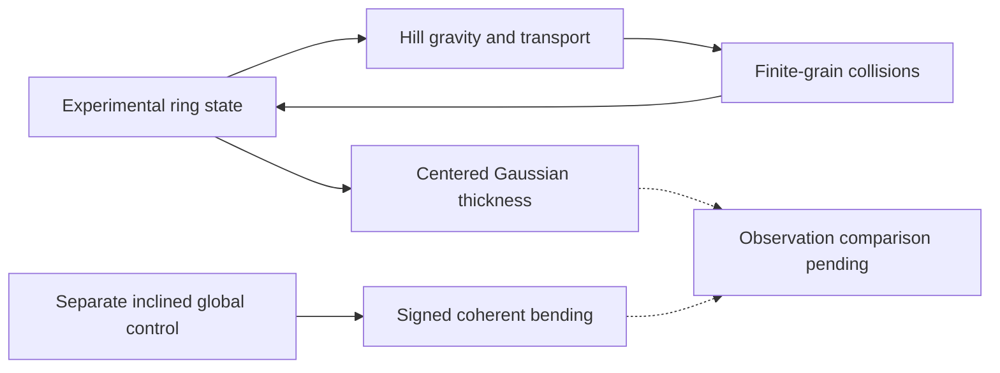

# Experimental finite-grain continuum control

This is an evolving Gaussian raw-moment Hill control with the native finite-grain collision backend. It is not a validated Keeler ring solution. Ring self-gravity, wakes, friction, spin, non-Gaussian velocity distributions and coherent signed bending are absent. The column stays centered at mean z=0. Its vertical second moments describe thickness/heating, not the coherent height in `baseline/inclined.py`.

## Run a bounded smoke

From the repository root, after the explicit native build:

```sh
python collision/native/build.py
python -m continuum.pilot --nx 32 --ny 128 --ylo -200 --yhi 200 --width 4 --end 0.06283185307179587 --threads 2 --output results/continuum-smoke
python -m unittest discover -s tests -v
```

The output directory must not exist. Choose a new path for each run. The default wall cap is 3300 seconds; `--max-wall-seconds` changes it. Wall checks occur after complete accepted steps, so a costly step can exceed the cap. `completion='wall_cap'` is partial output, not horizon success. The 2 GiB/four-core/one-hour project target still needs measurement for each evolving domain and horizon. Tests do not run full encounters.

`--ylo/--yhi` allow an asymmetric domain. The physical conjunction plane y=0 must coincide with an internal face. An exploratory long-domain choice is `--nx 32 --ny 272 --ylo -750 --yhi 100 --width 4 --end 21.87 --threads 4`; no long-run physical or numerical convergence is claimed by this integration. CLI options retain grid, CFL, radial domain, profile width, restitution, tag geometry, moon and collision switches. `--no-collisions` is an explicit numerical control. `--ring-gravity` fails because that physics is absent. There is one collision model: the native finite-size source. No legacy BGK solver or model switch is included.

## State and methods

Internal length is 1 km, time is Omega⁻¹, and number surface density is N/N0. Constants, physical moon mass and orbital scale are explicit in `pilot.py`. x is local radial distance; y is unwrapped azimuthal distance. This is a local Hill model, separate from the exact global REBOUND controls. `x+2w` is a local guiding-center proxy, not exact global semimajor axis or measured material retreat.

The ten extensive fields have shape `(10,ny,nx)`:

| Index | Field |
| --- | --- |
| 0 | n |
| 1–2 | n ux, n w, where w=uy+1.5x |
| 3–5 | n ux², n ux w, n w², including covariance |
| 6–8 | n H², n S, n W, with S=<z vz>, W=<vz²> |
| 9 | Tagged surface number density |

The smooth initial radial profile is integrated over each finite-volume cell. The tag contains the exact fractional initial mass in radial band [20,21] km and upstream interval [60,90] km, with configurable edges. It shares cell mean velocity and height; unresolved tag-position and tag-velocity covariance are omitted. Net face crossing is not an individual encounter age. No age model is included.

MC reconstruction contracts raw-moment face slopes into the realizable covariance cone and preserves cell means. Boundary-cell normal fluid slopes are zero because exterior states specify face data, not ghost-cell averages; complete interior-cell faces are unchanged. The shared cone contraction can also change tangential faces within boundary cells. This boundary discretization can change diffusion and must be used consistently in paired comparisons. Rusanov transport uses physical reservoir/vacuum boundaries and explicit boundary flux accounting. There is no periodic encounter, sponge or boundary reinjection of tagged outgoing material. The contact operator uses weighted gradients and traction, an explicit positive loss/gain Cayley map, contact virial support and bounded source substeps. Its boundary work and canonical momentum budgets are recorded. Contact positivity alone does not establish spatial accuracy. Source rejection, covariance failure and budget residuals must remain visible; no covariance floor or thermostat repairs a failed state.

The required API is `run(Config(...), ContactOperator(native.loss_gain, physics=pilot_module))`. The operator has no legacy helper import or fallback. The native backend and physical assumptions are documented in `collision/README.md`. Numerical parameters and finite-size applicability diagnostics do not establish physical validity. Occupied global extrema are retained; mass-weighted cohort extrema have an explicit retained-tag window and must not replace them.

## Outputs and provenance

Each run writes `config.json`, `summary.json`, `executed_source.py`, entry-time dependency snapshots and angular rule, initial/quarter-orbit frames, periodic progress and latest checkpoints, and final `checkpoint.npz`. Runtime dependency snapshots include the loaded native binary, under ignored results only. Final checkpoint keys are `state`, `initial`, `x`, `y`, and `history`; x has shape `(1,nx)`, y `(ny,1)`. Intermediate checkpoints additionally retain time and accumulated budgets. They are diagnostics, not a complete validated resume interface.

Collision/covariance failures write last accepted and failed states plus JSON diagnostics, then raise. Source hashes link results to the executed files. Keep failed output outside Git; do not relabel it as a successful horizon. The SI export and guarded synthetic-light bridge are documented in `../observation/BRIDGE.md`. No rendered solver results are included. Observation comparison remains pending.

`provenance.json` records the frozen source hashes and mechanical package changes. Before the intentional boundary reconstruction change, a canonical 32x128 short smoke exactly matched all five frozen checkpoint arrays and budget/time/step values after removal of the unused model path. That historical parity does not claim unchanged trajectories under the new boundary discretization. Thirteen of fourteen physical helpers remain AST-identical to the original; only limited_faces_fluid changes. Fast tests cover fractional tags, constant-fraction neutrality, conservative budgets, exact vertical rotation, true vacuum, contact boundary-work identity, positive covariance maps, contact-step refinement, wall-cap checkpoints and unique output paths. These are numerical controls, not a Keeler acceptance test. Primary collision equations and assumptions are linked in `collision/README.md`.


